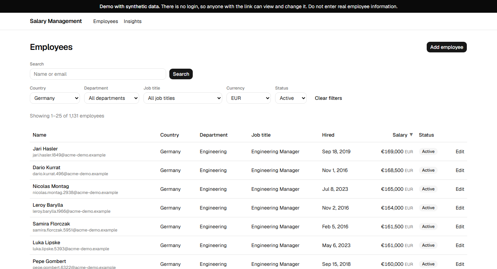
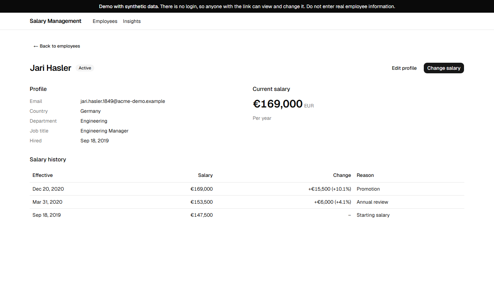
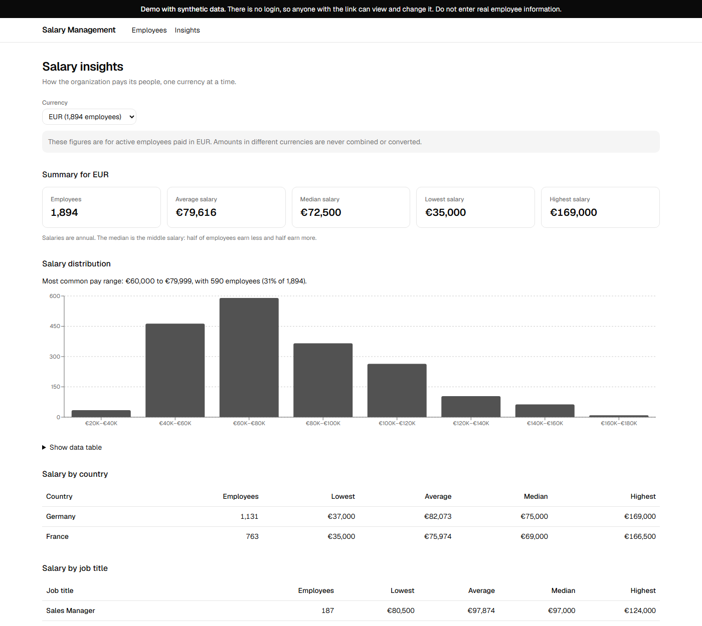
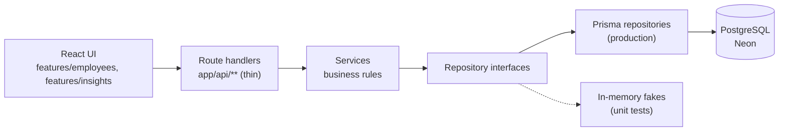

# Salary Management System

A web app for an HR Manager to manage salaries for an organization of 10,000 employees across several countries, and to answer questions like *"what do we pay engineers in Germany?"*.

> **Demo only.** It uses synthetic data and has no login, so anyone with the link can view and change it. Do not enter real employee information.

- **Live demo:** https://salary-management-system-beta.vercel.app/employees
- **Demo video:** _record separately before submitting_
- **Requirements and scope:** [docs/requirements.md](docs/requirements.md)
- **Design and architecture:** [docs/design.md](docs/design.md)
- **Trade-offs and deliberate omissions:** [docs/tradeoffs.md](docs/tradeoffs.md)
- **Performance considerations:** [docs/performance.md](docs/performance.md)
- **How AI was used, and what I corrected:** [docs/ai-workflow.md](docs/ai-workflow.md)

| Employee directory | Employee details and salary history |
|---|---|
|  |  |



## What it does

- **Employee directory.** Search by name or email. Filter by country, department, job title, currency and status. Sort any column. Everything (filtering, sorting, paging) runs in the database, so 10,000 rows stay fast. The view lives in the URL, so it can be bookmarked and shared.
- **Add, edit and deactivate employees.** Plain-language validation, duplicate emails caught at the database, and a confirmation before deactivating. Employees are **never deleted**, so salary history is kept.
- **Salary changes with history.** Every change adds a history record in the same database transaction as the salary update, so the two can never disagree. Two people changing the same salary at once cannot overwrite each other.
- **Insights.** Pick a currency and see headcount, lowest, average, median and highest salary overall, by country and by job title, plus a salary distribution chart with a text description and a data table.
- **One currency at a time.** Salaries in different currencies are **never added, averaged or compared**, and there is no conversion. Every insight takes a currency, and a missing one is an error, not a guess.

## Tech stack

Next.js (App Router) · React · TypeScript (strict) · PostgreSQL on Neon · Prisma · Tailwind CSS · shadcn/ui · Recharts · Zod · Vitest · React Testing Library

## Architecture



Route handlers only parse input (Zod), call a service and map errors to HTTP status codes. Business rules live in services. Services depend on repository **interfaces**, so they are tested with in-memory fakes and no database. A shared **contract test** runs against both the fake and the real Prisma repository, so the fake cannot quietly drift from real database behavior.

```
src/
  app/            pages and API route handlers
  components/     shared UI (shadcn/ui and small shared pieces)
  features/       UI and client logic: employees, insights
  server/         services, repository interfaces, Prisma repositories, HTTP error mapping
  seed/           deterministic synthetic data generator
  lib/            small shared helpers (formatting, API request, data hook)
  test/           fakes and test helpers
prisma/           schema, migrations, seed command
scripts/          checks and smoke tests (PowerShell and TypeScript)
docs/             requirements, AI workflow, screenshots
```

## Getting started

You need Node.js 22 and a free [Neon](https://neon.tech) PostgreSQL project.

1. **Install.** `npm install` (this also runs `prisma generate`).
2. **Configure.** Copy `.env.example` to `.env` and fill in the Neon connection strings. `.env` is git-ignored and must never be committed.
3. **Create the tables.** `npm run db:migrate`
4. **Add the 10,000 synthetic employees.** `npm run db:seed` (about 20 seconds). It does nothing if employees already exist. `npm run db:seed -- --reset` wipes and reseeds, so use it with care.
5. **Run.** `npm run dev` and open http://localhost:3000.

The seed is **deterministic**: the same command always produces the same 10,000 people across 8 countries and 7 currencies, with a realistic spread of pay, raises and a few deactivated employees.

### Scripts

| Command | What it does |
|---|---|
| `npm run dev` | Development server |
| `npm run build` / `npm start` | Production build and server |
| `npm test` | Unit tests (fast, no database) |
| `npm run test:integration` | Integration tests on a real PostgreSQL database |
| `npm run typecheck` / `npm run lint` | TypeScript and ESLint |
| `npm run db:migrate` | Apply migrations (uses `DIRECT_URL`) |
| `npm run db:seed` | Seed the demo data |

## Testing

- **Unit tests** (`npm test`): 508 tests across 34 files, no database, under a minute. They cover services, validation, formatting, the repository contract on the in-memory fakes, route handlers, and every React screen with React Testing Library, including loading, error and empty states and keyboard behavior.
- **Integration tests** (`npm run test:integration`): 69 tests against a real PostgreSQL database. They check what a fake cannot: unique constraints, transactions that roll back, two simultaneous salary changes (exactly one wins), SQL medians against hand-checked answers, and search characters like `%` and `_`.
- **The integration runner needs `TEST_DATABASE_URL`**, a separate database or Neon branch. The tests empty its tables, so the runner refuses to start if it matches `DATABASE_URL` or `DIRECT_URL`. Run the integration suite on its own: two runs at once deadlock on the shared test database.
- **Independent cross-check.** `npx tsx scripts/verify-insights.ts <url>` compares the live insights with figures computed separately in JavaScript from the same seed. It assumes the seeded data, and `--extra "country|jobTitle|currency|salary"` accounts for employees added afterwards.

## Deploying (Vercel + Neon)

1. Run steps 1 to 4 above, so the Neon database has its tables and data.
2. Push the repository to GitHub.
3. In Vercel, **Add New Project**, import the repository and keep the detected **Next.js** settings.
4. Add one environment variable, **`DATABASE_URL`**: the **pooled** Neon connection string (the host contains `-pooler`). Nothing else is required. `prisma generate` runs on install and needs no database.
5. Deploy, then check it: `powershell -File scripts/smoke-deployed.ps1 -BaseUrl https://your-app.vercel.app` (read-only, 13 checks).

`vercel.json` sets the function region to `iad1` (Washington, DC), close to a Neon database in `us-east-2`. If your Neon project is in another region, change it, because every query is a network round trip.

Because the demo has **no login**, anyone with the link can change the data. To restore it, run `npm run db:seed -- --reset` against the database. That deletes everything in it, so only do it on the demo database.

## Checks that prove the deployment will work

| Script | What it proves |
|---|---|
| `scripts/check-generate-without-env.ps1` | `prisma generate` works with no `.env` and no `DIRECT_URL`, and `migrate` still fails loudly instead of guessing a database |
| `scripts/check-build-without-database.ps1` | `next build` succeeds with every database address unreachable, and makes no database calls |
| `scripts/smoke-deployed.ps1` | A running deployment serves the pages and API correctly (read-only) |

## Scope

Deliberately left out, with reasons in [docs/requirements.md](docs/requirements.md): login and roles, currency conversion, bulk import, payroll, tax, attendance, leave, employee self-service and microservices.
