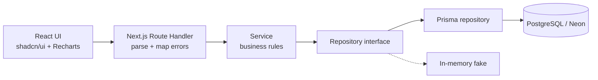
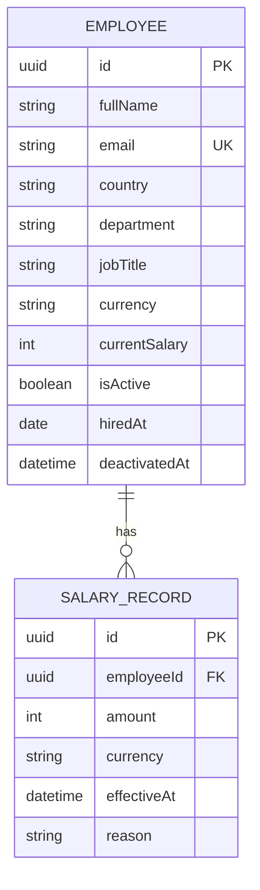

# Design and architecture

## Product boundary

The product has one persona, the HR Manager, and one primary job: maintain salary data and answer questions about how the organization pays people. This assessment version uses synthetic data, has no login and is not suitable for real salary data.

## Request flow

Route handlers are intentionally thin. They validate request bodies and query parameters with Zod, call a service, and convert known domain errors to HTTP responses. Services contain rules such as “employees are deactivated, never deleted”, “deactivated employees cannot receive salary changes”, and “salary and history change in one transaction”. Repository interfaces keep those rules independent of Prisma and make unit tests fast and deterministic.

## Data model

`Employee.currentSalary` and `Employee.currency` are the current snapshot used by directory queries and analytics. `SalaryRecord` is append-only history. Creating an employee creates its first salary record. Changing a salary updates the snapshot and inserts a history record in one Prisma transaction.

## Query behavior

- Employee search and filters run in PostgreSQL. The API uses database pagination and a whitelist of sortable columns.
- Name and email search uses case-insensitive contains matching. `%`, `_` and backslash are escaped so users search for literal text rather than SQL pattern wildcards.
- The directory adds `id` as a stable sort tiebreaker, so equal salaries cannot make rows repeat or disappear between pages.
- Insights always receive a currency. All aggregates filter active employees by that currency before calculating min, average, median or max.
- Median uses PostgreSQL `percentile_cont(0.5)`. The distribution uses SQL `width_bucket` over round, service-selected bucket edges.

## UI state

Directory filters, sorting and paging live in the URL. Employee and insights data load through client hooks that cancel stale requests and never display data belonging to a previous employee, page or currency. Every data screen has loading, error and empty states. Charts provide a visible summary and an equivalent data table for keyboard and assistive-technology users.

## Deployment boundary

Vercel runs the Next.js application and Neon stores PostgreSQL data. Runtime requests use Neon’s pooled `DATABASE_URL`. Prisma migrations use a separate direct URL locally or in an operator’s migration environment. Vercel only needs `DATABASE_URL`; `prisma generate` deliberately works without a database URL so the install/build step is independent of database availability.
